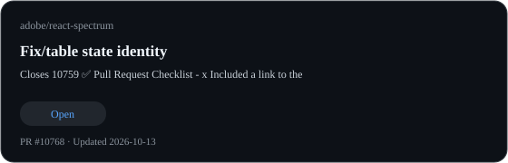
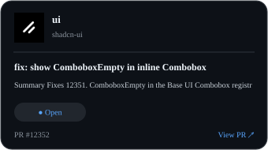
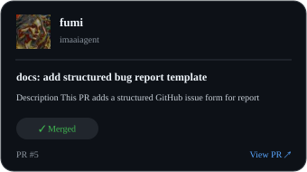
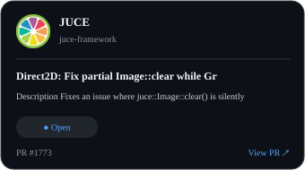
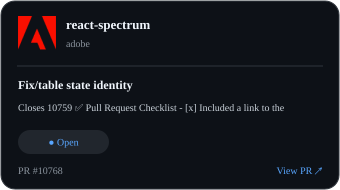
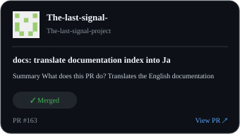
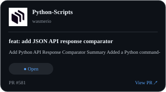
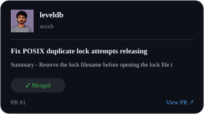
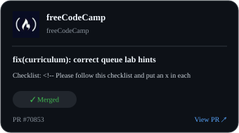

  

## 🌐 Socials:
 

# 💻 Tech Stack:
                              

<!-- CONTRIBUTIONS:START -->
## Open-source contributions

| Contribution | Contribution | Contribution |
|:---:|:---:|:---:|
|  |  |  |
|  |  |  |
|  |  |  |
|  |  |  |
|  |  |  |

*Showing 13 public pull requests. Updated automatically.*
<!-- CONTRIBUTIONS:END -->

