

  
   
  
  
  

 

&nbsp;&nbsp;&nbsp;&nbsp;&nbsp;&nbsp;&nbsp;&nbsp;&nbsp;&nbsp;&nbsp;&nbsp;

 
   <!-- SKILLS:START -->
   <!-- SKILLS:END -->

<!-- CONTRIBUTIONS:START -->
## Open-source contributions

**4 merged · 11 open · 1 closed**

<table>
<tr><td width="50%" align="center"><a href="https://github.com/The-last-signal-project/The-last-signal-/pull/163">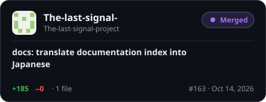</a></td><td width="50%" align="center"><a href="https://github.com/imaaiagent/fumi/pull/5">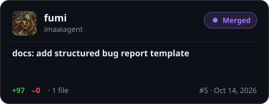</a></td></tr>
<tr><td width="50%" align="center"><a href="https://github.com/TanbirRamim/open-source-radar/pull/127">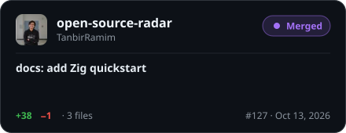</a></td><td width="50%" align="center"><a href="https://github.com/freeCodeCamp/freeCodeCamp/pull/70853">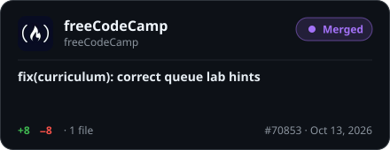</a></td></tr>
<tr><td width="50%" align="center"><a href="https://github.com/twbs/bootstrap/pull/43112">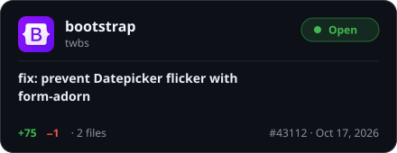</a></td><td width="50%" align="center"><a href="https://github.com/adobe/react-spectrum/pull/10768">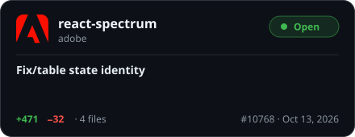</a></td></tr>
<tr><td width="50%" align="center"><a href="https://github.com/shadcn-ui/ui/pull/12352">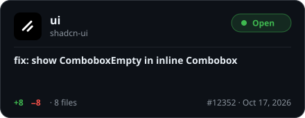</a></td><td width="50%" align="center"><a href="https://github.com/vercel/next.js/pull/100359">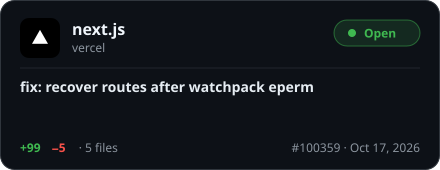</a></td></tr>
<tr><td width="50%" align="center"><a href="https://github.com/juce-framework/JUCE/pull/1773">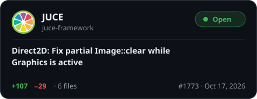</a></td><td width="50%" align="center"><a href="https://github.com/microsoft/fluentui/pull/36871">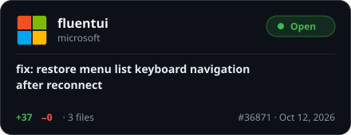</a></td></tr>
<tr><td width="50%" align="center"><a href="https://github.com/jupyter/notebook/pull/8089">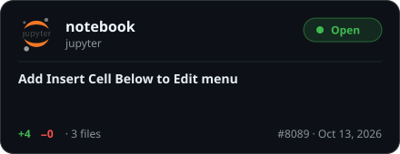</a></td><td width="50%" align="center"><a href="https://github.com/oven-sh/setup-bun/pull/188">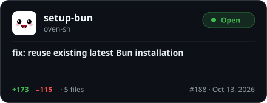</a></td></tr>
</table>

Showing 12 of 16 public pull requests · <a href="https://github.com/search?q=author%3Aasxxb%20type%3Apr%20is%3Apublic&type=pullrequests">see all</a> · updated automatically
<!-- CONTRIBUTIONS:END -->

