

  
   
  
  
  

 

&nbsp;&nbsp;&nbsp;&nbsp;&nbsp;&nbsp;&nbsp;&nbsp;&nbsp;&nbsp;&nbsp;&nbsp;

 

<!-- CONTRIBUTIONS:START -->
## Open-source contributions

**7 merged · 11 open · 4 closed**

<table>
<tr><td width="50%" align="center"><a href="https://github.com/lingdojo/kana-dojo/pull/34764">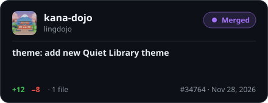</a></td><td width="50%" align="center"><a href="https://github.com/public-transport/transitous/pull/2744">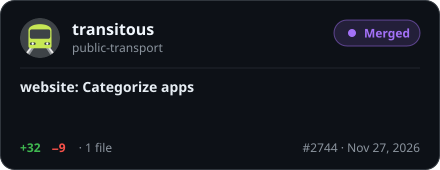</a></td></tr>
<tr><td width="50%" align="center"><a href="https://github.com/microsoft/fluentui/pull/36871">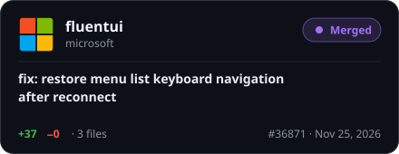</a></td><td width="50%" align="center"><a href="https://github.com/The-last-signal-project/The-last-signal-/pull/163">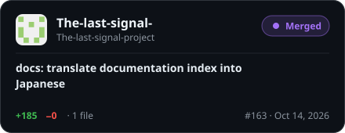</a></td></tr>
<tr><td width="50%" align="center"><a href="https://github.com/imaaiagent/fumi/pull/5">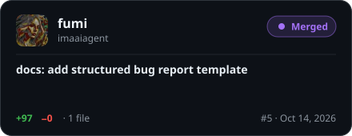</a></td><td width="50%" align="center"><a href="https://github.com/TanbirRamim/open-source-radar/pull/127">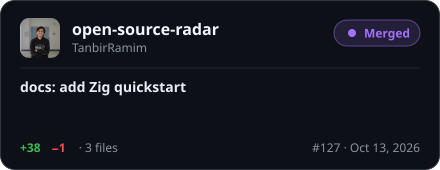</a></td></tr>
<tr><td width="50%" align="center"><a href="https://github.com/freeCodeCamp/freeCodeCamp/pull/70853">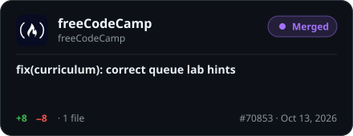</a></td><td width="50%" align="center"><a href="https://github.com/meta/hermes/pull/2340">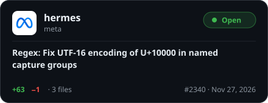</a></td></tr>
<tr><td width="50%" align="center"><a href="https://github.com/uutils/coreutils/pull/16910">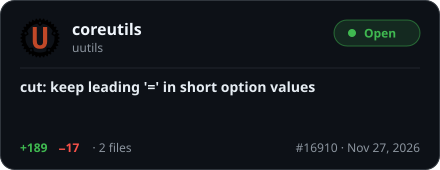</a></td><td width="50%" align="center"><a href="https://github.com/vercel/next.js/pull/100359">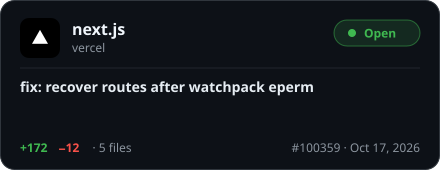</a></td></tr>
<tr><td width="50%" align="center"><a href="https://github.com/pixijs/pixijs/pull/12306">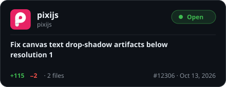</a></td><td width="50%" align="center"><a href="https://github.com/shadcn-ui/ui/pull/12352">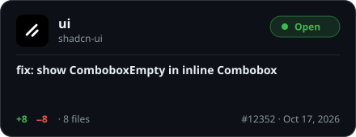</a></td></tr>
</table>

Showing 12 of 22 public pull requests · <a href="https://github.com/search?q=author%3Aasxxb%20type%3Apr%20is%3Apublic&type=pullrequests">see all</a> · updated automatically
<!-- CONTRIBUTIONS:END -->

   <!-- SKILLS:START -->

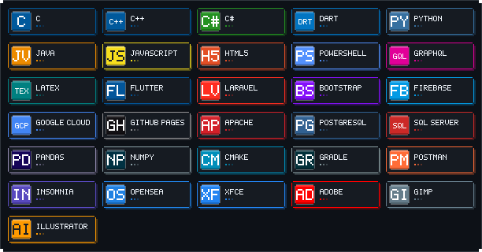

<!-- SKILLS:END -->

